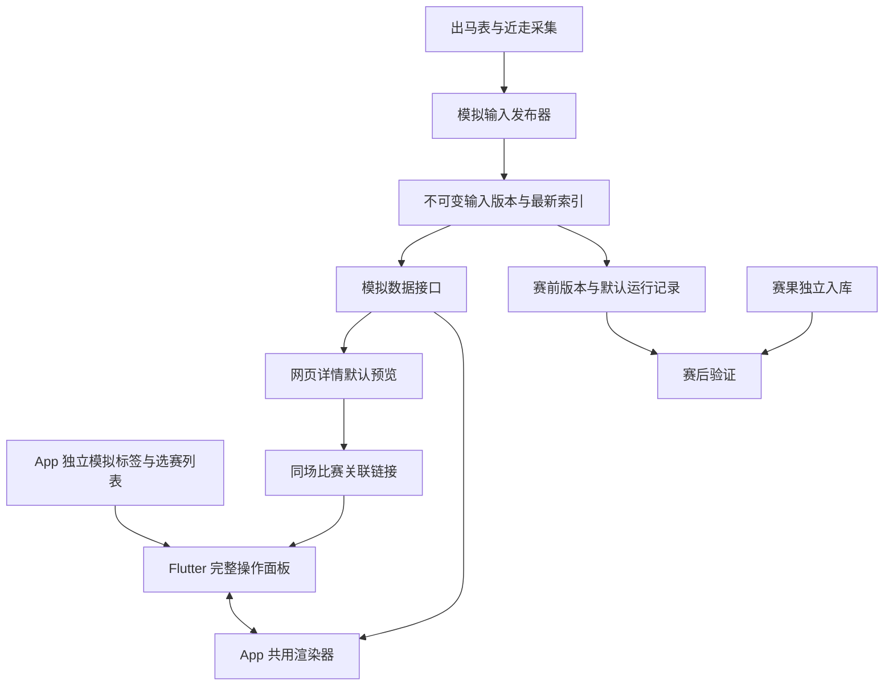

# 每场赛前模拟、网页预览与 App 引流实施计划

状态：待实施。本文仅规划，不表示以下功能已经上线。

工作分支：`codex/race-simulator`。

## 1. 交付目标与首版边界

当天每场有有效出马表的中央、地方平地赛，都能在比赛详情页看到一次默认模拟；用户进入 Android / iOS App 后，可以改变展开条件、查看马匹状态、反复模拟并保存设置。网页和 App 使用相同的输入、模拟核心与默认模型。

App 导航采用最新确定的结构：保留5个底部标签，用第3个 `シミュレーション` 替换原 `日報`。模拟器与 `My予測` 一样拥有独立首页和状态，用户可直接从标签中寻找比赛，也能从网页或普通比赛详情直达指定比赛。

首版完成四条闭环：

1. 赛前资料采集完成后，模拟即可使用，不绑定 Agent 整场分析完成。
2. 网页详情页加载该场真实输入，提供完整的默认试跑。
3. App 独立模拟标签提供选赛和完整操作，网页入口能打开该标签中的同一场比赛。
4. 保存赛前输入版本和默认模拟记录，赛后独立评估，同时记录引流与实际使用情况。

模型功能分层与精度分开管理：App 的价值是操作、比较和保存能力。两端精度说明一致；本期沿用既有默认模型，第三版研究模型保持试验状态，后续模型切换另走验证流程。

首版范围：中央和地方平地赛、在线使用、单场模拟、200次按需统计、单设备偏好保存。障碍赛、带广挽曳、账号云同步、完整离线模拟、付费权限和安装后跨平台自动接续，列为后续独立事项。现有预测、My予測、广告和通知流程保持兼容。

日报调整范围是移除其底部标签。历史日报数据、网站页面及旧链接继续保留兼容访问，不将删除日报数据纳入本期工作。模拟器参照 My予測 的独立页面与状态保留方式，不自动沿用其奖励广告访问规则。

## 2. 已核对的工程基础

|现状|本次接入点|
|---|---|
|`frontend/src/main.jsx` 的 `/keiba/simulator` 为独立试验页|拆出共用渲染组件，保留实验入口；增加 App 渲染路由|
|`RaceSimulatorPage.jsx` 读取6场固定样例|生产入口按比赛ID加载；生产数据未准备好时显示状态|
|`raceSimulator.js`、`historicalRaceProfiles.js` 已支持固定种子和模型参数|复用引擎，定义可版本化的调用协议|
|赛程与详情来自 `/keiba/api/public/board`、`/keiba/api/public/races/{race_path}`|赛程增加轻量可用性字段，详情按需获取模拟输入|
|Agent 审计可包含 `inputs.race_data`，也可能只有 prediction_only|完整审计可作兼容来源；提前可用依靠采集阶段新发布的输入|
|`flutter/README.md` 指定 Flutter 为 Android / iOS 共用实现，旧 `android/` 留作比较与切回|以 Flutter 为主交付线，核对在架旧 Android 的兼容行为|
|Flutter 已通过 WebView 展示网页，`AppWeb` 保留 `app=1`|共享网页渲染器，完整操作面板由 Flutter 提供|
|`HomeShell` 将前3个标签作为网页，通知中的 `reports` 也映射到索引2|改为前2个网页标签、第3个原生模拟根页面，日报旧目标另做兼容路由|
|目前 Android Manifest 与 iOS 关联域名配置未覆盖模拟链接|增加系统关联链接、冷启动与运行中路由|
|网页现有下载卡只有 Android 入口|改为支持两端且能保留当前比赛的功能入口|
|网页有分析事件工具，App 有 Firebase Analytics|补充模拟与引流事件，避免内嵌网页重复上报|

现有 `app=1` 是布局标记。高级面板放在 App 组件中，不以一个查询参数作为功能分层的唯一依据。

## 3. 用户流程与功能划分

|能力|网页比赛详情|App 完整模拟|
|---|---|---|
|该场马匹、赛道与最新资料版本|支持|支持|
|默认完整试跑、暂停、相同条件重播|支持|支持|
|播放位置拖动、倍速、跟踪马匹|首版保持基础预览|支持|
|步速、波动、另一个随机展开|使用统一默认值|支持|
|赛道视角、马群视角与马匹状态|简化展示|支持|
|200次统计与条件方案比较|展示功能入口|支持，明确为模型内频率|
|设置与场景保存|保留当前跳转上下文|本地保存，可恢复和重置|
|当前资料版本与更新时间|显示|显示|

### 网页

比赛详情 → 模拟区进入视口后加载资料与渲染资源 → 点击播放完整默认试跑 → 在模拟区查看 App 能力说明 → 主动点击 App 入口。

默认预览可完整看完。首次不自动弹下载窗口，不一次性在赛程列表计算所有比赛。资料不足的马使用明示缺省估计；资料尚未到达的比赛显示准备中，其他比赛的样例不会替代目标比赛。

### App

底部进入模拟标签 → 当天可模拟比赛列表 → 选择场地和比赛 → 完整模拟页 → 改变展开、查看状态、运行统计 → 保存场景或返回模拟选赛列表。

从网页关联链接或 App 普通比赛详情进入时，直接选中模拟标签并打开对应比赛，携带的输入版本、默认模型和种子优先于本地个人设置。

个人偏好（倍速、视角）与单场方案（步速、比较距离、种子等）分别保存，避免上一场的试验条件套入下一场。从网页进入时优先保持传入比赛与版本，用户再选择应用个人设置。

### App 底部标签与模拟首页

|索引|标签|职责|
|---|---|---|
|0|`レース`|既有比赛列表和详情|
|1|`履歴分析`|既有历史分析|
|2|`シミュレーション`|独立的模拟选赛、单场模拟和设置|
|3|`My予測`|既有自定义预测，保持独立|
|4|`その他`|既有其他入口|

模拟首页首版包含：

- 默认当天，按中央/地方、场地筛选，比赛按有来源的发走时间排序。
- 优先查看未开跑比赛，并可切到当天全部比赛；开赛状态未知时明确标记，不把缺赛果等同于尚未开跑。
- 卡片显示场地、场次、距离/马场种类、发走时间、出走头数、资料可用状态和更新时间。
- 可用或部分资料比赛进入模拟；准备中可重新检查状态；不支持类型说明原因。
- 提供最近查看比赛的继续入口；切换标签保留筛选、滚动位置、所选比赛、参数和播放位置。
- 离开标签暂停动画并停止未完成的重复计算，保留已完成统计；返回后由用户继续。输入更新仍按版本提示处理。

首版不增加第6个标签。标签和页面标题均使用完整的 `シミュレーション`，配专用模拟图标；在小屏和系统大字体下检查换行、截断及触控区域，不擅自缩写为其他文案。

新增用户可见文案统一用日语，例如 `展開シミュレーション`、`アプリで展開を変える`、`データ準備中`、`資料不足`、`更新あり`。现有无关文案保持原样。

## 4. 总体架构



模拟数学核心继续用现有 JavaScript。网页预览和 App 渲染器共享赛道、马匹布局、时间采样和模型配置；Flutter 管理完整设置、场景比较、保存与页面导航。

引擎、渲染、操作面板分开，固定步长计算与动画绘制分开。200次任务进入可取消的后台计算或分批队列；输入、模型或场景变化后，旧任务结果不能覆盖新页面。

## 5. 赛前数据发布与接口

### 5.1 发布时机与来源

新增独立的模拟输入发布器，写入 `pipeline/data/simulator_inputs/`，不改写现有 Agent 预测、赛果和审计目录。

- 采集器得到有效 `RaceData` 后即发布 `input_ready`。若在远端采集，扩展现有任务回传协议，让输入可先于预测结果到达。
- 当天赛程中的全部受支持比赛进入轻量采集队列，而不是只覆盖已完成预测的比赛。按比赛ID去重、限制并发，失败后重试并保持准备中状态。
- 兼容已有任务：可以从完整审计提取赛前输入；只有预测分数、没有出马表的任务显示准备中。
- 新采集到的有效名单、马场状态等更新可产生新版本。已有版本保持不变，更新最新版本索引。
- 不因网页点击触发一次新的大模型分析。服务端读取已发布输入，缓存白名单化后的响应。

临场刷新复用既有调度并由采集更新事件触发；在阶段0核对实际采集频率与来源约束后确定频率配置。页面检查新版本使用缓存校验请求，不承诺上游尚不具备的秒级更新。

涉及现有任务接入点：`pipeline/race_job_worker.py`、`pipeline/v5_remote_tasks.py`、`pipeline/web_admin/remote_predictors.py`，以及 `web_app.py` 中的 Agent 结果接收逻辑。实施时先定位实际采集进程与回传边界，再确定发布钩子。

建议新增模块：`pipeline/web_data/simulator_inputs.py`、`pipeline/simulator_input_store.py`。存储格式采用不可变版本文件与最新索引，写入使用原子替换；本期不增加自动清理原始资料的逻辑。

### 5.2 输入合同

|字段组|用途和约束|
|---|---|
|`schema_version`、`race_id`、`race_date`|合同版本、规范比赛ID、日本比赛日|
|`race_info`|场地、马场种类、距离、内外回、马场状态与天气；未知值明确保留|
|`scheduled_off_at`、`race_state`|有来源的发走时间和状态；缺少时间时使用未知状态|
|`input_version`、`input_hash`、`source_as_of`、`published_at`|追溯输入内容、来源时点和发布时点|
|`availability`、`missing_fields`|准备中、可用、部分资料或不支持等状态|
|`horses`|马号、枠号、身份、名称、骑师、负重、出走/取消/除外状态，以及允许的近走字段|
|历史时钟与末段|只关联更早的比赛，马匹身份、日期、距离、名次需一致；匹配歧义保留缺失|
|`active_model_version`、`default_seed`|统一默认模型与默认展开；研究版本另行标记|
|`provenance`|来源类型与必要的版本标识，不返回服务器内部文件路径|

名单没有变化时，不因一次请求时间变化就重建内容版本。名单、历史资料、条件等有效输入变化才更新内容哈希；获取时间作为独立元数据。

所有近走必须日期严格早于目标比赛日，且比赛ID不等于目标比赛。赔率、人气、目标赛果、预测总分、内部分析和审计附带的记忆资料不进入模拟输入。后端使用明确字段白名单，不能把整份审计直接公开。

历史时钟查询来自 Agent 已有的历史结果与身份索引，不依赖本机 `analysis_outputs/` 或训练脚本运行时缓存。接口、网页和 App 使用一致的历史关联规则；若规定近走条数上限，需先验证影响并写入版本合同，不随设备性能静默裁剪。

### 5.3 路由与缓存

建议接口：

```text
GET /keiba/api/public/simulator/races?date=YYYY-MM-DD&scope_key={scope}&state={state}
GET /keiba/api/public/simulator/races/{race_id}?date=YYYY-MM-DD
GET /keiba/api/public/simulator/races/{race_id}?date=YYYY-MM-DD&input_version={version}
GET /keiba/api/public/simulator/models
```

使用独立 `simulator` 前缀，避免被现有 `/races/{race_path:path}` 捕获。是否提供无 `/keiba` 的别名与现有代理配置一致。

赛程接口只增加模拟可用状态、最新版本等小字段，完整近走在打开该场详情时获取。当前比赛ID、日期、响应中的比赛身份不一致时中止加载。不存在、准备中、不支持和临时错误有不同响应状态，前端不以最近一场比赛兜底。

独立模拟标签的列表接口返回当天赛程与模拟可用状态的轻量集合，包括尚在准备中的比赛，不能仅列出已完成 Agent 预测的比赛。它与网页赛程可用性共用同一服务，完整近走仍只在进入单场后读取。

最新索引使用短缓存并带 ETag；指定版本按不可变内容缓存。输入更新只提示用户切换，正在播放的轨迹仍绑定原版本，避免途中跳变。退赛更新后须重新构建参赛列表并使旧统计失效。

## 6. 共用渲染与网页默认预览

从现有试验页拆出以下职责：

|建议组件或模块|职责|
|---|---|
|`RaceSimulationRenderer.jsx`|场地、马匹、播放位置与选中马的共用展示|
|`RaceSimulatorPreview.jsx`|比赛详情中的基础预览与 App 入口|
|`SimulatorEmbedPage.jsx`|App 中的共用渲染页面，不携带完整网页设置面板|
|`simulatorClient.js`|获取输入、版本和状态，取消过期请求|
|`simulatorModels.js`|稳定/研究模型登记及兼容版本选择|
|`simulatorBridge.js`|App 操作协议与渲染事件|

`RaceDetailPage.jsx` 嵌入预览；`main.jsx` 明确区分试验页与 `/keiba/simulator/embed` 渲染路由。固定样例保留用于开发，生产入口始终绑定真实比赛ID。

现有独立完整试验页仅在开发环境或受控内部测试中开放。正式站点的 `/keiba/simulator` 提供基础预览与 App 入口，不继续公开完整网页设置面板；添加 `app=1` 也不会出现 Flutter 中的高级操作组件。

网页基本操作：播放、暂停、同一默认种子重播。两端相同版本、种子和条件应得到一致的逻辑轨迹；跨浏览器引擎按数值容差验证，不以逐字节相同作为要求。复用组件时必须用现有固定样例核对终点用时与顺位，若数学行为变化则更新模型版本。

性能验收基线在阶段0选择普通 Android 真机和 iPhone：预览按需加载；切到后台停止动画；200次统计可取消；降低绘制细节不能改变模拟结果。首版先建立实际耗时、内存与流畅度基线，再确定预算，不在计划中承诺未经测量的帧率。

## 7. App 完整操作与桥接

Flutter 用模拟标签替换日报标签，提供独立的选赛根页面和内部单场页面。普通比赛详情和网页链接为补充入口，最终都进入同一个模拟标签。建议文件：

- `screens/simulation_home_screen.dart`：当天选赛、场地筛选、可用状态与继续模拟入口。
- `screens/race_simulation_screen.dart`：完整操作面板与页面状态。
- `services/simulation_service.dart`：轻量列表、单场输入、刷新与请求取消。
- `models/simulation_context.dart`：比赛、输入版本、模型版本、种子和方案。
- `services/simulation_settings.dart`：全局偏好与按比赛保存的场景。
- `services/simulation_link_service.dart`：冷启动、前台和后台链接接收。

同时修改 `home_shell.dart`、`native_nav_icon.dart` 和导航测试：第3个标签使用独立图标和原生根页面；共享网页只服务比赛和历史分析。使用明确的标签/页面映射替代“索引就是 `AppSection` 枚举下标”的假定。

模拟标签自身维护“选赛列表 → 单场模拟”的返回栈。单场返回先回到选赛列表，切换其他标签保持各自状态；在模拟根页面触发系统返回时按统一外壳返回规则处理，不直接丢弃其他标签的页面历史。My予測的设置、激活状态和访问规则不与模拟器共用存储键。

日报兼容：现有 `reports` 通知、`/reports` 与日报详情链接通过独立网页页面打开，返回原入口；不能继续把 `reports` 数字索引2解释成模拟器。移除底部入口时不删除旧日报页面或数据，也不默认增加其他新菜单入口。

复用现有 WebView 能力，但模拟桥与通用平台配置通道分开。协议需声明版本、请求ID和当前比赛身份。

|App → 渲染器|渲染器 → App|
|---|---|
|初始化、播放、暂停、拖动位置|就绪、当前状态、选中马|
|设置步速、波动、视角和试验条件|方案已变更、输入版本更新提示|
|运行/取消统计、重置默认|统计进度、统计完成、可读错误|

仅在指定站点和模拟页面启用桥接，命令与参数有白名单、边界及版本检查。旧请求的回调不能串入下一场。重新创建 WebView、网络恢复或进程重启后，可以从保存的上下文恢复。

App 支持原比赛条件与假设场景比较。改变距离、场地等时明确为试验条件，原始比赛资料保持原样。新版数据到达时提示重新试跑，保存的场景保留其输入版本；版本不可用时提示用户选择最新资料，不能静默换场。

## 8. 网页到 Android / iOS 的同场跳转

### 8.1 统一入口

采用一个受控HTTPS关联入口。下面仅为路由示意，关联域名需在阶段0核对控制权、DNS和证书：

```text
https://{关联域名}/open/simulator/{race_id}
  ?date=YYYY-MM-DD&iv={input_version}&mv={model_version}
  &seed={seed}&source=web_detail
```

系统可打开已安装 App 时，选中第3个模拟标签并直接进入对应比赛；否则显示网页落地页，提供匹配系统的官方商店按钮和返回比赛预览入口。手机浏览器不被假定为能可靠检测是否安装了 App；不以一个超时就认定唤起失败。

网页比赛详情仍正常可访问。关联链接匹配仅覆盖明确的 App 打开路径，避免把所有网页访问都强制跳入 App。iOS 场景需要专门测试 Safari 的同域导航行为，必要时使用独立关联子域。

上下文包括比赛、输入版本、默认模型、种子和入口来源。所有路径与参数校验后，再归一化到现有主站渲染地址；不直接加载外部传来的任意URL。

### 8.2 Android 与 iOS 配置

|平台|工作|
|---|---|
|Android|Manifest 增加已验证 HTTPS App Links；站点根路径发布 `/.well-known/assetlinks.json`；使用 Google Play 实际签名证书指纹，区分正式版与调试版|
|iOS|增加 Associated Domains；站点根路径发布 `/.well-known/apple-app-site-association`；核对 Team ID、bundle ID、路径匹配和正式签名|
|Flutter|以官方 Router 路线统一接收冷启动、运行中链接；处理初始化前到达的待执行上下文与重复事件，避免两套接收器同时导航|
|旧 Android|确认商店更新后的兼容行为。未支持完整协议的版本保留网页预览与升级入口，逐步由 Flutter 正式版承接|

两个关联文件需在公开HTTPS地址直接正确返回；不能只加在本机 `/keiba` 静态目录后就认为域名验证完成。正式验证使用真实发布身份，且不把签名私钥或本地配置写入仓库。

### 8.3 首次安装后的接续

首版保证已安装用户可到同场；未安装用户可到正确商店。落地页保留比赛上下文，提示安装后返回原页面点击打开该场。

“安装完成首次启动自动恢复比赛”属于单独增强，不能由系统关联链接直接推断为已支持。后续可评估 Android 安装来源回传及 iOS 合适的接续方式，另列验收；首版不为此引入账号、跨应用指纹识别或自动读取剪贴板。

## 9. 版本保存、赛后验证与引流事件

### 版本与验证

- 输入、模型、默认种子、设置、运行时间与代码版本共同组成一次模拟记录。
- 默认记录保存可重算的输入引用和统计，不要求存储每一帧动画。
- 模型和输入在赛后保持原版本；新赛果进入独立评价流程，不回填成更好看的赛前轨迹。
- 记录输入获取时点、发走时间来源和冻结时点。只拿到计划发走时间或时间未知的记录不能宣称已经证明实际发走前冻结。
- 评价继续以汇总前五覆盖实际前三为主要指标，同时报告单次覆盖、完整覆盖场次、冠军保护指标、用时误差与概率误差。
- 没有末段实测标签时记为不可评价；保留中央/地方、样本数量、缺失情况和日期范围。新数据仅用于固定模型补充验证，调参需新的独立留出。

### 引流与使用

|事件|定义|
|---|---|
|`sim_preview_impression`|预览区实际进入视口，按单次页面访问去重|
|`sim_preview_start` / `sim_preview_complete`|用户开始/完成一次默认预览|
|`sim_app_cta_click`|用户主动点击完整模拟入口|
|`sim_store_click`|点击对应商店按钮，只表示商店点击|
|`sim_app_open`|App 成功接收并打开该场模拟|
|`sim_tab_open` / `sim_race_select`|用户主动进入模拟标签、在标签中选择比赛|
|`sim_app_first_complete`|App 首次完成一场模拟，按安装内事件规则去重|
|`sim_settings_change` / `sim_batch_complete`|高级功能实际使用|

公共维度包括比赛ID、输入/模型版本、入口来源、网页/App、平台与功能协议版本。入口区分 `app_tab`、`web_detail`、`app_race_detail` 等，以比较主动使用与网页引流。网页和 App WebView 不重复计数；App 内由原生分析通道上报。沿用既有分析开关，分析不可用时模拟仍可使用。

先分别看播放率、App入口点击率、商店点击与App实际使用，不把它们串成未经验证的安装归因。能正确关联的上下文再计算闭环；首版不承诺跨商店、跨设备完整追踪。

## 10. 分阶段工作与验收

|阶段|主要交付|依赖|验收条件|
|---|---|---|---|
|0：合同与发布配置核对|确定5标签结构、默认模型、输入/桥接合同、关联域名、商店地址、正式包身份、兼容版本和真机基线|无|字段、导航矩阵和测试清单固定；缺少的外部配置明确登记，不使用虚构商店地址|
|1：赛前输入与动态单场|发布器、不可变存储、历史时钟关联、单场API、赛程可用性状态|0|真实未开跑平地赛可读取；不等LLM完成；缺资料和取消能正确表达；目标赛果与行情字段不进入响应|
|2：网页默认预览|共用渲染器、详情嵌入、基础操作、资源按需加载与状态提示|1|从当天不同比赛进入均为正确马匹/场地；可完整看完；重播不变；现有详情布局和预测信息正常|
|3：App独立模拟标签与完整操作|替换日报标签、当天选赛页、Flutter单场页、桥接、进度/条件控制、200次统计、方案比较和本地保存|2|保持5标签；Android/iOS可从模拟标签独立选赛；任务可取消；切换标签保留状态；日报旧链接兼容，My予測不受影响|
|4：双端跳转与商店承接|统一关联链接、系统关联文件、冷/暖启动路由、下载落地页|0、3|已安装用户选中模拟标签并到同场同版本；未安装用户到正确入口；旧版本、拒绝打开和内置浏览器有可用回退|
|5：记录、埋点、整体验证|赛前运行记录、赛后评价、事件去重、完整故障与兼容测试|1—4|固定记录可重算；数据与参数来源可追溯；商店点击和App使用分别可观测|
|6：分批开放|功能开关、App版本门槛、支持场地逐批启用与回退配置|5|先内部测试，再小范围开放；异常时关闭入口即可恢复原详情页，数据记录保留|

每阶段作为独立可审查提交，全部继续在当前模拟器分支开发。先做动态单场数据与网页预览，再做 Flutter 完整面板和系统跳转，最后开放引流。此顺序让页面先有真实可用体验，再引导下载。

本计划不承诺未经验证的固定工期；阶段0完成后按实际数据回传接口、签名和域名准备情况估算。商店审核、域名部署和iOS签名真机验证单独计入交付依赖。

## 11. 必做测试与发布门槛

|层级|重点场景|
|---|---|
|数据与API|中央/地方、部分近走、无近走、取消/除外、错误ID/日期、重复采集、早版/临场更新、固定版本读取、历史身份歧义、行情/赛果字段隔离|
|引擎与共用组件|现有固定样例回归、相同版本/种子重播、新旧模型登记、网页/App逻辑一致、资料更新提示、换场清空统计、计算取消|
|网页|详情加载、可见后加载、低速网络、API故障、不可用状态、移动布局、完整播放与App入口、无分析上报仍正常运行|
|App|5标签顺序、独立选赛、准备中/部分资料、标签状态保留、单场返回列表、My予測独立性、日报旧通知与链接、长标签/大字体、Android WebView与iOS WKWebView、冷暖启动、网络恢复和旧协议回退|
|关联与商店|正式签名安装/未安装/旧版、Chrome/Safari/常见内置浏览器、关联失败、用户选择留在网页、未知或过期版本、Android/iOS商店按钮|
|观察与评价|网页和App事件去重、同场上下文、记录时点真实性、缺末段标签、不按新赛果更改参数、中央/地方分开报告|

发布门槛：身份与版本不可串场；关键状态和回退可用；Android/iOS正式身份的关联链接均经真机验证；网页默认预览和App完整操作都能闭环；已有App功能通过回归。iOS构建与真机验收需使用Mac/Xcode或既有macOS构建环境，Android通过不能替代iOS验收。

## 12. 开始实施前需准备的外部配置

- 确认实际在架Android版本、Flutter正式更新包与签名身份。README和构建配置的版本信息不完全一致，以实际发布配置为准。
- 确认iOS是否已上架及真实商店地址；未具备入口时如实标注，先保留可用网页体验。
- 确认生产关联域名控制权、HTTPS与站点根路径的静态文件部署方式。
- 获取正式Android应用签名证书的公开指纹、iOS Team ID与关联域名配置权限；私钥不进入计划或仓库。
- 提供Android与iPhone真机及iOS构建环境，用于跨端播放、桥接和系统链接验收。

上述配置影响发布，不阻塞先完成本地数据合同、组件拆分和网页/Flutter联调。

## 13. 技术依据

- [Flutter官方深层链接与Router行为](https://docs.flutter.dev/ui/navigation/deep-linking)：冷启动与运行中链接均要处理；单一接收路线避免重复导航。
- [Flutter底部导航组件](https://api.flutter.dev/flutter/material/NavigationBar-class.html)：导航项、选择状态与标签布局在实际屏幕上验收。
- [Android官方App Links](https://developer.android.com/training/app-links/about)：需要网站与正式应用签名的关联；未安装时仍有网页落点。
- [Apple官方网页与App内容关联](https://developer.apple.com/documentation/xcode/allowing-apps-and-websites-to-link-to-your-content)：通过关联链接进入App对应内容；具体行为需在目标系统和浏览器验证。
- 本仓库依据：`flutter/README.md`、`flutter/lib/src/web/`、`frontend/src/components/RaceDetailPage.jsx`、`pipeline/web_app.py`、`pipeline/web_data/agent_predictions.py` 以及现有模拟器与第三版验证记录。
